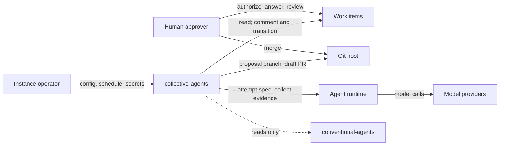
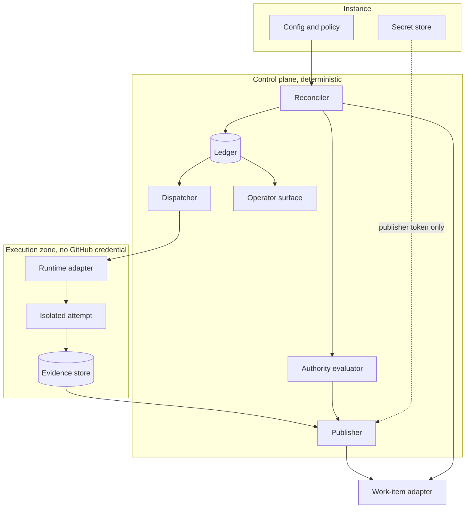

<!--
PARSING_HINTS:
- This document provides architectural context and boundaries.
- Prefer ADRs for explicit decisions.
- Prefer feature specs for behavior and requirements.
- Do NOT refactor architecture unless explicitly instructed.
- Use this document to understand layering, responsibilities, and constraints.
- This is an unadopted candidate draft archived for comparison. It is not
  the canonical docs/ARC42.md, not an accepted decision, and not an
  approved FS or PLAN. Do not implement from it.
-->

# Architecture Overview (arc42): collective-agents, candidate draft

## Provenance and reading guide

- **Author:** Claude Opus 5.5 (`anthropic/claude-opus-5-5`) in Claude Code,
  2026-09-28.
- **Sources, per `BRIEF.md`:** bootstrap `trunk` at `e322e52`; pinned
  conventional-agents at `94b784a`; the PR #1 research memo at `6d2a94b`;
  the pinned arc42 template; ADRs with front-matter status checked, not
  read from the index.
- **Independence caveat, read first.** The brief excludes PR #1's
  `docs/ARC42.md`. This author's session wrote that file and the research
  memo earlier (under Claude Sonnet 5), and later saw an external review
  of PR #1. That context could not be removed. This draft was written from
  scratch without copying or reopening PR #1's arc42, but it is **not
  independent of it** in the way the four routed drafts were asked to be.
  The author did not read PR #2 or any of the four model drafts.
- **Template note.** The pinned template has ten numbered sections; the
  brief asks for eleven. This draft keeps the template's ten in order and
  adds §11 Glossary.

Citation keys: `CA` is a path or ADR in pinned conventional-agents;
`CA gh-binding` is `integrations/github-issues-projects.md`; `R §n` is a
section of the research memo. Every property is labelled:

- **Enforced:** a platform or store technically prevents the alternative.
- **Detectable:** a violation is visible after the fact, not prevented.
- **Proposed:** this draft's design intent; nothing enforces it yet.

## 1. Introduction and Goals

### 1.1 Requirements Overview

collective-agents is the execution layer conventional-agents deliberately
is not. The framework will never do workflow orchestration (CA ADR-0007),
and an agent-runtime binding may not ship a scheduler, daemon or hook that
mutates governed work items (CA ADR-0039 §3). collective-agents is a
separate product that performs that orchestration while submitting to the
framework's rules of conduct.

Its job, per work item: decide whether a currently valid, human-originated
authorization exists for a specific action; if so, run isolated agent
attempts that return evidence; validate the evidence against authority as
it stands at publication time; and publish at most one canonical proposal,
typically one draft PR, or park the item visibly for a human. It never
approves, never merges, and never treats agent output as authority.

Core vocabulary (full definitions in §11):

- **Work item:** the substrate's unit of governed work (CA FS-0018).
- **Intent:** one kind of action on a work item, such as drafting a spec,
  implementing, or a follow-up. Distinct intents are distinct authorities.
- **Generation:** one authorized action and scope for an intent, bound to
  the authorizing human act and a base commit. The unit of one canonical
  proposal, stable across retries.
- **Attempt:** one runtime execution for a generation. Attempts carry no
  authority. A retry is a new attempt, never a new generation.
- **Evidence:** what an attempt returns: a patch against the base commit,
  a summary, test results and the actual model identity.
- **Publication:** an external write made for a generation: a branch, a
  draft PR, or a work-item comment or transition.

Not the product's concern: which repositories, identities, credentials,
schedules, model choices and budgets an instance uses (instance policy);
approval and merge (human acts).

### 1.2 Quality Goals

Ranked. Each scenario states the property class that holds today.

1. **Authority safety.** *Scenario:* a `task` generation is mid-attempt
   when a human changes the item's Type to `feature`. *Response:* the
   publisher re-reads authority before any write, finds it no longer
   matches the generation, publishes nothing, and records the generation
   as superseded. *Class:* Proposed. The Type field itself is only
   Detectable on GitHub, which has no per-field ACL (CA gh-binding §2,
   R §5).
2. **The engine cannot merge.** *Scenario:* a defect or injected
   instruction makes the publisher request a merge. *Response:* GitHub
   refuses because branch protection excludes the publisher identity from
   pushing or merging to protected branches. *Class:* Enforced by branch
   protection when configured (R §5). The absence of any merge call in
   the engine is Proposed defense in depth.
3. **Credential containment.** *Scenario:* an issue body tells the worker
   to push, comment or merge. *Response:* the worker holds no GitHub
   credential and cannot reach GitHub; the instruction yields at most a
   patch the publisher validates. *Class:* Proposed. It becomes Enforced
   only with mechanical isolation (§8.2). Hermes documents a
   trusted-local-user threat model by default (R §5).
4. **No blind duplicate publication.** *Scenario:* the publisher crashes
   after GitHub accepted a draft PR but before the ledger recorded it.
   *Response:* the next pass finds the branch and PR by the generation's
   deterministic key, adopts a content match and parks on a mismatch.
   *Class:* Detectable plus Proposed. This is not exactly-once; GitHub
   offers no conditional writes (R §4).
5. **Convergence despite missed events.** *Scenario:* a webhook is
   dropped. *Response:* the next scheduled pass sees the same state and
   acts. *Class:* Proposed; CA ADR-0028 is the contract. Scheduler
   liveness is only Detectable, and only if monitored: GitHub Actions
   schedules are best-effort and auto-disable after 60 days without
   repository activity (CA gh-binding §6; GitHub states the auto-disable
   for public repositories:
   <https://docs.github.com/en/actions/using-workflows/events-that-trigger-workflows#schedule>).
6. **Reconstructable decisions.** *Scenario:* an operator asks why draft
   PR N exists. *Response:* one ledger query returns the work item,
   intent, generation, the human act that authorized it, each attempt with
   selected and actual model, evidence digests, validation results and
   the publishing identity. *Class:* Proposed. Neither GitHub nor Hermes
   retains this join (R §1, R §5).
7. **Operable without transcripts.** *Scenario:* an operator starts the
   day. *Response:* every item needing a human is marked on the work-item
   surface, and one status command lists in-flight, parked, stale and
   budget-exhausted generations. *Class:* Proposed.
8. **Replaceable substrate and runtime.** *Scenario:* a second runtime
   adapter is added. *Response:* reconciler, authority evaluator, ledger
   and publisher do not change. *Class:* Proposed, and unverifiable until
   a second adapter exists (CA ADR-0024 ordering rule).

### 1.3 Stakeholders

- **Human maintainer and approver:** the sole source of authorization and
  merge; wants few, clearly framed decision requests.
- **Instance operator:** runs one or many repositories; wants a small
  configuration, unambiguous failure signals and cost visibility.
- **Product adopter:** wants to run collective-agents without forking it.
- **Proposal reviewer:** wants draft PRs whose provenance and evidence are
  legible without reading agent transcripts.
- **conventional-agents maintainers:** want contract gaps raised upstream
  as proposals, not patched around locally.
- **Security and audit:** want credential boundaries that are mechanical
  and a decision trail that survives comment deletion.

## 2. Constraints

### 2.1 Binding constraints (accepted in pinned `94b784a`)

- **Merge and identity gates.** Agents never merge; identity is verified
  before every `gh` operation or push. Non-overridable (CA ADR-0012).
- **Autonomous gate.** Phase checkpoints keyed on Type; an unset Type is
  treated as most restrictive (CA FS-0018 §Autonomous Gate, ADR-0019).
- **Parked state.** While `question` is set, an agent performs no
  transition except removing it once a human resolves it (CA ADR-0020).
- **Unattended identity.** A distinct actor email, `mode=autonomous` and
  a specific `session=<job-name>` on every unattended action
  (CA ADR-0021).
- **Approval is a recorded human act.** An agent may record approval but
  may not be the approval (CA ADR-0026).
- **Level-triggered reconciliation.** The reconciler carries correctness,
  events only accelerate, and passes are idempotent (CA ADR-0028).
- **Substrate capabilities.** Six capabilities; Type, parked state and
  activity record are attributable, not enforced (CA ADR-0024,
  CA `integrations/README.md`).
- **Background-task authority.** An unattended session's authority comes
  from human-authored job configuration. Tasks it spawns declare role,
  artifact scope, channel and commit permission; authority never widens
  by delegation; a background task may not push or open a PR
  (CA ADR-0014).
- **Collaboration integrity.** A consensus or review-board round needs
  distinct models with independent state and fails with a configuration
  error rather than degrading to one model (CA ADR-0023).
- **Attribution.** Commit `user.name` carries the model, `user.email` the
  actor; the `Agent-Attribution:` trailer is authoritative (CA ADR-0029,
  CA `workflows/git-and-gh-conventions.md`).
- **Runtime bindings are setup only.** CA ADR-0039 governs how a runtime
  is configured to follow the framework; it defines no dispatch API.
- **Current-state discipline.** A current-state document must not state a
  proposed ADR's rule as fact (CA ADR-0030 rule 3).

### 2.2 Proposed ADRs, cited only as direction

- **ADR-0032** (template and instance forms) is `proposed`. The rule that
  the product carries no instance data is agreed product direction from
  the human, not an accepted ADR.
- **ADR-0035** (worktree-only mutations, per-session sandboxes) is
  `proposed`. It supports §8.2 but does not bind.
- **ADR-0036** (attribution vocabulary) is `proposed`. The
  provider-qualified `model=` form is cited from the current-state
  workflow document instead.

### 2.3 Organizational constraints

- No implementation before an approved FS and PLAN (CA ROLE_CONTRACT,
  spec-first rule).
- No candidate integration presented as shipped (`AGENTS.md`). The Hermes
  kanban substrate binding is a draft that does not yet conform
  (CA FS-0038, CA `docs/proposals/hermes-kanban-substrate-binding.md`).
- Contract gaps are raised upstream, not absorbed as local
  reinterpretation.
- Credentials never live in Git.

## 3. Context and Scope

### 3.1 Business Context



What crosses each boundary:

- **Human approver.** In: authorization acts, answers to `question`,
  review and merge. Out: decision requests and draft PRs.
- **Work-item substrate** (GitHub Issues and Projects first). In: items,
  Type, Phase, labels, activity. Out: stance entries, links, and only
  those transitions the gate and instance policy permit.
- **Git host.** Artifact authority. Out: proposal branches and draft PRs
  only; never a write to a protected branch.
- **Agent runtime** (Hermes Agent first). In: an attempt specification.
  Out: evidence and attempt status. No path from the runtime to GitHub.
- **Model providers.** Reached only through the runtime. Their billing is
  the likely cost source; R found no per-run cost field (R §2, R §8).
- **conventional-agents.** A read-only contract; the product never edits
  the vendored tree.

### 3.2 Technical Context

- **Substrate reads:** on-demand enumeration (capability 6) over GitHub
  GraphQL and REST, within primary and secondary rate limits.
- **Substrate writes:** comments, labels and Phase, through the publisher
  only. GitHub has no conditional writes: REST `PATCH` is unconditional
  and Projects v2 field mutations accept no precondition (R §4).
- **Events:** an optional accelerant. GitHub does not redeliver failed
  webhooks automatically; `X-GitHub-Delivery` supports deduplication
  (R §4).
- **Git:** attempts read a pinned base commit. Only the publisher pushes,
  create-only and never forced.
- **Draft PR:** created with `draft: true`; it cannot merge while draft,
  and CI still runs by default (R §3).
- **Dispatch:** a port collective-agents defines (§5.3), not ADR-0039.
- **Ledger:** an engine-owned durable store (§5.4).
- **Instance configuration:** one local file or an instance repository,
  with secrets referenced by name (§8.7).

In scope: reconciliation, authority evaluation, reservation, dispatch,
evidence collection and validation, publication, parking, attribution and
operator reporting.

Out of scope: approval, merge, the governance contract itself, runtime
setup (CA ADR-0039 bindings), a GitHub-to-Hermes board mirror
(CA FS-0038 non-goals), multi-tenant hosting.

## 4. Solution Strategy

1. **Deterministic control plane, probabilistic workers.** Reconciler,
   authority evaluator and publisher are deterministic code; models run
   only inside attempts. This keeps CA ADR-0028's acknowledged
   oscillation risk (two passes over identical state reaching different
   conclusions) out of the control loop. *Proposed; needs an ADR.*
2. **Explicit, versioned, re-checked authority.** Each canonical proposal
   belongs to exactly one generation. A generation is created only from a
   recorded human act and is re-validated at publication. An edited issue
   body never creates a generation by itself.
3. **Four credential zones.** A read-only reconciler; a dispatcher that
   can start attempts but cannot write GitHub; workers with no GitHub
   credential at all; and one publisher that is the only GitHub writer
   and is excluded from merge by branch protection (§8.2).
4. **Ledger first, discovery before every external write.** A generation
   and attempt are reserved in the ledger before dispatch. Before each
   external write the publisher looks for an existing publication by the
   generation's deterministic key, and parks on unresolved ambiguity
   instead of retrying blind (§8.3).
5. **Evidence is data, never instructions.** Worker output is validated
   like untrusted input; claims inside it, such as "tests passed", are
   recorded and then checked independently where possible.
6. **Mechanism in the product, policy in the instance.** The product
   evaluates model, budget, cadence and path policies; the instance
   supplies them (§8.6, §8.7).
7. **The work item is the human interface.** Anything needing a human is
   shown on the work item, not only in runtime logs (R §8).
8. **Binding first, abstraction second.** GitHub and Hermes adapters are
   written in full first; ports are generalised only where a second
   adapter proves the shape (CA ADR-0024).

Governance reading, *Proposed:* a reconcile run is an unattended primary
session whose authority is its human-authored instance configuration; each
attempt is a background task it spawns (CA ADR-0014). On that reading,
ADR-0014 already requires the evidence-return design: a background task
may not push or open a PR, and its default channel is non-committing
output. Head Architect confirmation of this reading is an open item
(OD-12).

## 5. Building Block View

### 5.1 Level 1



### 5.2 Responsibilities

- **Config resolver:** loads the local file or instance repository,
  validates it, fails closed on missing required keys, and records a
  configuration digest on each generation.
- **Reconciler:** enumerates work items, joins them with ledger state, and
  asks the authority evaluator what, if anything, is due. Read-only
  substrate credential.
- **Authority evaluator:** a pure function from (item state, ledger,
  policy) to a decision: no action, create generation, retry attempt,
  publish, supersede or park. Used at dispatch time and again at
  publication time.
- **Ledger:** the durable record of intents, generations, reservations,
  attempts, evidence digests, publications and parks.
- **Dispatcher:** turns a reservation into an attempt through the runtime
  adapter; holds a lease; never touches GitHub.
- **Runtime adapter:** implements the dispatch port for one runtime. The
  Hermes adapter is the first; how it invokes Hermes (kanban task or a
  direct worker invocation) is open (OD-6).
- **Isolated attempt:** executes in an environment with no inherited
  credentials, a scratch checkout at the base commit, and egress limited
  to model endpoints and any mirrors policy allows.
- **Evidence store:** content-addressed storage for patches, summaries,
  test output and runtime receipts.
- **Publisher:** re-validates authority, validates evidence, discovers
  existing publications, then pushes the proposal branch, opens the draft
  PR and writes stance entries and comments. The only GitHub writer.
- **Work-item adapter:** implements the six capabilities for one
  substrate plus the publication operations.
- **Operator surface:** a status command over ledger and substrate state.

### 5.3 Ports (candidate shapes; an FS fixes them)

- **WorkItemSource:** `enumerate()`; `read(item)` returning a stable id,
  Type, Phase, labels, body digest, update time and activity references.
- **Dispatch:** `submit(spec) -> handle`; `status(handle)`;
  `collect(handle) -> evidence`; `cancel(handle)`. The spec carries
  repository URL, base commit, instructions, intent and generation ids,
  allowed tools, budget, selected model policy and an ADR-0014 spawn
  declaration (role, scope, channel, `Commit: no`). It carries no GitHub
  credential.
- **Publication:** `find(key)`; `push_branch(key, commit)` create-only;
  `open_draft_pr(key, body)`; `comment(item, body)`;
  `transition(item, phase)` only where policy allows (OD-3).
- **LedgerStore:** atomic `reserve(generation, attempt)`; leases with
  expiry; append-only state transitions.

### 5.4 Ledger conceptual model

- **Intent:** work item reference and action kind.
- **Generation:** intent, authorization record reference and digest, base
  commit, configuration digest, policy decision (selected model, budget,
  review requirement) and ordinal *n*. Immutable once created.
- **Attempt:** generation, ordinal, runtime handle, selected model, actual
  model as reported by the runtime, lease expiry, outcome and evidence
  digest.
- **Publication:** generation, kind, deterministic key, external
  reference, and state `intended`, `confirmed` or `ambiguous`.
- **Park:** generation or item, reason class (§8.9), and the human-visible
  reference that surfaces it.

Invariants, *Proposed:* at most one active reservation per generation; at
most one confirmed canonical proposal per generation; no publication
without a generation whose authorization re-validated at publish time.

Deterministic key: branch `ca/<item>/<intent>/g<n>` and a matching body
marker. Branch lookup by name is a direct API read, which this draft
prefers over search-index queries whose freshness was not verified.

## 6. Runtime View

### 6.1 Candidate flow: a `task` generation to a draft PR

This example uses a `task` because its gate is the simplest to trace. It
is not a recommendation for the first slice (OD-1).

Preconditions: resolved configuration; the item's Type is `task`, set by
a human; an authorization record exists for the `implement` intent
(its form is OD-4); `question` is absent.

```mermaid
sequenceDiagram
  participant S as Scheduler
  participant R as Reconciler
  participant L as Ledger
  participant D as Dispatcher
  participant W as Attempt
  participant P as Publisher
  participant G as GitHub
  S->>R: tick
  R->>G: enumerate and read item N
  R->>L: load intents and generations
  R->>R: evaluate authority
  R->>L: create g1; reserve a1 (atomic)
  D->>W: spec: base SHA, instructions, no creds
  W-->>D: evidence: patch, summary, tests, model
  D->>L: a1 complete; evidence digest
  P->>G: re-read item N
  P->>L: take publish lease on g1
  P->>G: find branch and PR for key g1
  P->>G: push branch, create-only
  P->>G: open draft PR with marker g1
  P->>L: publication confirmed
  P->>G: stance entry, then link comment
```

1. **Evaluate.** The reconciler reads item N and the ledger. The
   authority evaluator checks: Type set by a human; authorization record
   present and by a human actor on the instance allowlist; `question`
   absent; minimum dispatch evidence satisfied (OD-2); budget available.
   *Proposed.* Actor verification rests on data GitHub makes Detectable,
   not Enforced.
2. **Reserve.** The ledger creates generation g1 and reserves attempt a1
   atomically. *Enforced by the ledger store* if a single authoritative
   store is used; *Proposed* otherwise.
3. **Dispatch.** The dispatcher submits the spec. The attempt runs
   isolated. *Proposed* until isolation is mechanically demonstrated
   (§8.2, OD-10).
4. **Collect.** Evidence is stored by digest; a1 is marked complete.
5. **Re-validate.** The publisher re-reads item N. If Type, authorization
   or `question` changed, it records `superseded` or parks and publishes
   nothing. A body edit alone is noted in the proposal but does not by
   itself invalidate the generation.
6. **Validate evidence.** The patch applies to the base commit; changed
   paths stay within the generation's scope and outside instance reserved
   paths; size and secret checks pass (§8.4).
7. **Discover, then write.** The publisher looks up the branch and PR for
   key g1. None: push the branch create-only, open the draft PR, record
   `confirmed`. Present with a matching tree: adopt and record
   `confirmed`. Present with a different tree: record `ambiguous`, park,
   write nothing else.
8. **Report.** A stance entry immediately precedes each work-item
   transition or comment (CA FS-0018), with `mode=autonomous`,
   `session=<job-name>` and the actual model.
9. **Phase.** FS-0018's gate lets an agent advance a `task` up to In
   Progress, and its success criteria move an In Progress `task` to In
   Review when its PR opens. Whether the engine performs either
   transition or leaves them to a human is OD-3; this flow shows neither
   as settled.
10. **Stop.** A human reviews, marks the PR ready and merges, or closes
    it. The engine never merges. The next pass observes the outcome and
    closes the generation in the ledger.

### 6.2 Failure and recovery paths

- **Transient attempt failure** (crash, timeout, rate limit). Detected by
  attempt outcome or lease expiry. Response: a new attempt under the same
  generation, within the retry budget. When the budget is exhausted,
  park with reason `budget_exhausted`. Not `question`, which is reserved
  for genuine human input.
- **Worker requests input** (Hermes `needs_input`). Response: set
  `question` with the worker's question as a comment; no further
  transitions until a human resolves it (CA ADR-0020).
- **Lost or zombie worker.** Its lease expires and the attempt is marked
  lost. A zombie can still finish, but it has no publication path; its
  late evidence is recorded against a closed attempt and ignored. This is
  the main safety dividend of evidence return.
- **Authority changed mid-attempt.** The generation is superseded at
  publication; evidence is kept; nothing is published.
- **Publisher crash after a remote write.** The next pass discovers the
  branch or PR by key; a match is adopted, a mismatch is parked
  `ambiguous`. Detectable only: there is no transaction across the
  ledger and GitHub.
- **Crash between reservation and dispatch.** The reservation's lease
  expires; before starting another attempt, the dispatcher asks the
  runtime for any attempt tagged with that reservation id. Whether a
  runtime supports such a lookup is part of OD-6.
- **Two reconciler processes.** The ledger's atomic reservation stops the
  second. Running the ledger as local SQLite on two hosts is an
  unsupported topology.
- **Scheduler stops.** No pass records a heartbeat; an external liveness
  check alerts. Silence is an outage, not a delay (CA ADR-0028).
- **Rate limit or secondary limit.** Back off exponentially and serialize
  mutating calls; the pass ends early and the next resumes.
- **Evidence fails validation.** The generation is parked with reason
  `policy_denied` and the failing check is named on the work item.

### 6.3 Creating a new generation

A new generation requires a new recorded human act for that intent: a
fresh authorization, or an explicit request to redo. An issue body edit, a
label an agent applied, or an agent comment does not qualify. The
previous generation's open draft PR is left for the human; the engine
comments that it is superseded and never closes it automatically.
*Proposed.*

### 6.4 Event-accelerated pass

A webhook or other event may start a pass early, scoped to the affected
item. Deduplicate on delivery id. The schedule still runs (CA ADR-0028).

## 7. Deployment View

### 7.1 Options

- **D1, local scheduled CLI.** One host runs the CLI under an OS scheduler
  (cron, launchd or a systemd timer). Hermes runs on the same host. The
  ledger is a local SQLite file; configuration is one local file.
  Credentials come from the host keychain into the publisher process
  only. Fits one repository and one operator. Its weakness is a single
  host with no external liveness monitor unless one is added.
- **D2, CI-scheduled.** The reconciler and publisher run on a GitHub
  Actions schedule. The ledger cannot live on an ephemeral runner, so it
  needs an external store or a dedicated state branch. Attempts need a
  runtime host, such as a self-hosted runner. Subject to best-effort
  schedules, the 60-day auto-disable and `GITHUB_TOKEN` limits.
- **D3, portfolio service.** A long-running service or scheduled job
  serves many repositories, with a server-grade ledger (for example
  PostgreSQL), an instance repository for registry and policy, and one
  or more runtime hosts. Hermes kanban is single-host by design (R §2),
  so each runtime host owns its own attempts while the ledger remains the
  single coordinator.

### 7.2 First-slice recommendation

D1, as a scheduled CLI rather than a persistent service, consistent with
R §8. A persistent service earns its cost only once event acceleration is
added, and ADR-0028 keeps events secondary regardless.

### 7.3 Where state and secrets live

- **Git:** code, proposal branches, attribution trailers (authoritative
  over comments, CA gh-binding §5).
- **Work-item substrate:** current Type, Phase, labels and comments. No
  field history (R §2).
- **Runtime:** attempt execution records and logs; single-host for Hermes
  kanban.
- **Ledger:** the join across all of the above; instance-owned data.
- **Instance configuration:** policy and identifiers; secret *names*
  only.
- **Secret store:** the publisher token, the read token and model provider
  keys, each delivered only to the component that needs it.

### 7.4 Smallest single-repository configuration (illustrative)

- Repository and default branch.
- Substrate binding and board identifiers (the shape of
  CA `config/project.example.yml`).
- Reserved paths (the shape of CA `config/gates.example.yml`, fail-closed
  when absent).
- Human approver allowlist.
- Unattended actor name and email (CA ADR-0021) and the job name used for
  `session=`.
- Runtime adapter and profile, and a model policy of one rule.
- Retry budget per generation and an attempt timeout.
- Ledger location.
- Secret names for the read token, publisher token and provider key.

A portfolio adds a repository registry, an identity strategy (one
unattended actor per repository or one shared actor told apart by
`session=`), cross-repository schedule liveness checks, and shared model
and budget policy. That is when an instance repository earns its cost; at
one repository it is optional.

## 8. Cross-Cutting Concepts

### 8.1 Authority model

- An intent is a kind of action; a generation is one authorized instance
  of it; an attempt is one try.
- Authority is derived only from human acts the instance recognises and
  from the pinned gate. Agent comments, agent-applied labels, worker
  output and issue body text are never authority.
- Authority is checked twice: before reservation and before every
  external write. The second check governs.
- The authorization record must identify a human actor. GitHub makes this
  Detectable at best. Projects v2 exposes no field history (R §2); whether
  a current field value exposes its last setter was not verified. This is
  why the record's form is open (OD-4).

### 8.2 Credential and isolation boundaries

- **Reconciler:** a read-only substrate token.
- **Dispatcher:** runtime access; no GitHub token.
- **Attempt:** no GitHub token, no `gh` configuration, no SSH agent, no
  host home directory; a scratch checkout at the base commit; egress
  limited to model endpoints. Provider keys, if the runtime needs them in
  the sandbox, are scoped to that attempt.
- **Publisher:** the only GitHub writer. Issues, pull requests and
  project write; excluded from pushing or merging to protected branches
  by branch protection, which is the actual merge-gate mechanism; token
  scope is defense in depth (R §5).

Isolation must be mechanical. A profile name or an instruction is not a
boundary. Hermes documents its boundary as the toolset enabled per
profile, under a trusted-local-user threat model (R §5); any host
isolation must come from how the runtime is deployed, not from kanban.
The product should refuse to dispatch unless the runtime adapter passes a
credential-absence probe inside the sandbox (OD-10).

CI is a second exposure. Same-repository branches normally run workflows
with repository secrets, and a proposal can change the code CI executes.
Path filtering cannot make untrusted code safe in a job that holds
secrets. Options: publish proposal branches from a publisher-owned fork,
so workflows run without repository secrets; or restrict which jobs run
for engine-authored branches. This is well-known Actions behaviour that
was not re-verified in R, and it is open as OD-11.

### 8.3 Reservation, idempotency and publication recovery

- **Reservation.** Atomic in the ledger store. Enforced only if there is
  one authoritative store.
- **External writes are not exactly-once.** GitHub may accept a write
  whose acknowledgement is lost. The publisher therefore discovers before
  writing and after crashing.
- **Git supplies one real primitive.** Git's push protocol updates a ref
  only if its current value matches what the client expects, so the
  publisher can push create-only and never force; a racing second writer
  fails rather than overwriting. On rejection the publisher compares tree
  hashes, not commit hashes, since commit metadata differs between runs.
  These are Git mechanics; confirm the behaviour against GitHub in the FS.
- **PR creation.** GitHub is observed to reject a second open PR for the
  same head and base; this was not verified in R and must be confirmed
  in the FS before any design relies on it.
- **Comments have no natural deduplication.** The publisher lists the
  item's comments for the generation marker before posting. A duplicate
  comment is tolerable and Detectable.
- **Leases are advisory to GitHub.** GitHub cannot check a ledger lease,
  so a stale publisher could still write. The Git ref rule above, the PR
  head rule and single-publisher topology bound this; they do not
  eliminate it.
- **Ambiguity parks.** When discovery cannot tell whether a prior write
  succeeded, or finds conflicting content, the generation parks for a
  human. No automated compensating deletes.

The guarantee this design aims for is at most one confirmed canonical
proposal per generation, with every exception visible. It does not claim
exactly-once publication, and nothing here has been fault-tested.

### 8.4 Evidence handling

- Evidence is content-addressed and immutable once collected.
- **Validation before publication:** patch applies to the base commit;
  paths within the generation's scope; nothing under instance reserved
  paths unless the generation explicitly covers them; size limits; secret
  scan over patch and summary; no binary blobs unless policy allows.
- Test results reported by the worker are claims. CI on the draft PR is
  the independent check, subject to §8.2's CI exposure.
- Evidence text shown to later models, such as a reviewer, is framed as
  untrusted data.

### 8.5 Attribution and audit

- Stance entries use the FS-0018 format with `mode=autonomous`, a role
  from the role contract, the actual model and `session=<job-name>`
  (CA ADR-0021).
- The publisher creates the commit from the evidence patch. Author name is
  the actual model's display name and author email the unattended actor's
  (CA ADR-0029); the committer is the publisher identity; the
  `Agent-Attribution:` trailer carries the provider-qualified model
  (CA `workflows/git-and-gh-conventions.md`). No human `Co-authored-by`
  line is added.
- Selected and actual model are both recorded. If they differ through a
  runtime fallback, the proposal says so.
- If the runtime cannot attest the actual model, it is recorded as
  unknown, and anything that depends on it, such as review independence,
  cannot be claimed (OD-13).
- The ledger is the durable join. Comments are convenient but deletable;
  commit trailers survive; the ledger links both.

### 8.6 Model selection policy

- **Mechanism, product:** evaluate ordered instance rules at generation
  creation; record the decision and the policy digest; pass the selected
  runtime profile and model to the attempt; capture the actual model.
- **Inputs:** Type, intent, labels, whether scope touches reserved paths,
  repository risk tier, prior attempt outcomes and remaining budget.
- **Outputs:** runtime profile, primary model, permitted fallback chain,
  per-attempt caps, maximum attempts, and whether an independent review
  is required.
- **Budgets:** attempts per generation are Enforced by the ledger;
  time and token caps are Enforced only if the runtime enforces them,
  otherwise Detectable afterwards; periodic spend is Detectable only when
  cost data exists, and R found none per run (R §2, R §6).
- **Fallback and review independence:** a runtime-level fallback can
  silently change the author model (Hermes `fallback_model`, R §6). For a
  consensus or review-board round, CA ADR-0023 already requires distinct
  models: the round fails with a configuration error, the workflow may
  proceed, and no artifact claims independent judgement. This draft
  proposes the same rule for any author-and-reviewer pairing: if
  independence cannot be shown, the review is not recorded as
  independent. Whether the item then waits is instance policy.
- **Evidence for choices:** none claimed yet. The ledger can accumulate
  per-model outcomes; the draft FS-0031 benchmark harness is a possible
  future source.

### 8.7 Configuration resolution

- Two forms: a single local file for one repository, or an instance
  repository for a portfolio. Same schema; the instance repository adds a
  registry.
- Resolution is relative to the caller's repository or an explicit path,
  in the spirit of CA ADR-0033 and FS-0024.
- Required keys fail closed when absent, following the reserved-paths
  stance in CA `config/gates.example.yml`.
- Secrets are referenced by name and resolved at runtime from a secret
  store; configuration in Git holds no values.
- The configuration digest is recorded on every generation, so the policy
  that authorized a proposal can be recovered later.

### 8.8 Observability

- **Work item:** every human-required state, with a one-line reason and
  a next step.
- **Draft PR:** evidence summary, validation results, generation and
  attempt ids, and the selected and actual model.
- **Operator status command:** in-flight, parked (by reason), stale
  leases, budget use, last successful pass per repository.
- **Runtime logs:** for deep debugging only; never the only place a
  required action appears.
- **Cost:** from runtime or provider data where available, otherwise
  reported as unknown rather than estimated.

### 8.9 Error and park taxonomy

- `retryable`: transient runtime or API failure; retried within budget.
- `needs_human`: genuine input request; uses `question`.
- `budget_exhausted`: retries used up; human-visible, not `question`.
- `superseded`: authority changed; no publication.
- `ambiguous`: external state unresolved; human-visible, no retry.
- `policy_denied`: evidence failed validation; human-visible.
- `config_error`: fails closed; the pass stops for that scope.

FS-0018's label vocabulary has no label for non-`question` blocked states,
so their human-visible representation is open (OD-8).

### 8.10 Verification strategy

- Fake substrate and runtime adapters for deterministic tests.
- Fault injection at each crash point: after reservation, after dispatch,
  after remote write before acknowledgement, and during discovery.
- Property to test: across injected crashes, no generation has more than
  one confirmed canonical proposal, and every other outcome is parked.
- An isolation acceptance test that the credential-absence probe fails
  loudly when a token is present.

## 9. Architectural Decisions

### 9.1 Decisions consumed

The accepted ADRs in §2.1 bind this design. collective-agents has no ADRs
of its own yet.

### 9.2 Agreed direction awaiting a local ADR

These come from the human, per the brief. Each needs a local ADR before
it binds:

- Git is artifact authority; GitHub and Hermes are the first pair, not
  core dependencies.
- Work-item substrate and runtime invocation are separate concerns.
- One local configuration file or an instance repository; no credentials
  in Git.
- A generation is the unit of a canonical proposal; runs are attempts.
- Workers return evidence without GitHub credentials; a separate
  publisher validates and publishes; the publisher never merges.
- Ledger-first reservation, discovery before writes, park on ambiguity;
  no exactly-once claim.
- Level-triggered reconciliation; `question` only for genuine human input.
- Selected and actual model attributable; model identities, fallback and
  budgets are instance policy.

### 9.3 Decisions this draft proposes

- **P-1:** a deterministic control plane, with models only inside
  attempts (§4).
- **P-2:** authority re-validated at publication, governing over the
  dispatch-time check (§8.1).
- **P-3:** create-only branch pushes and tree-hash comparison as the
  discovery primitive (§8.3).
- **P-4:** an isolation probe as a dispatch precondition (§8.2).
- **P-5:** review independence is never claimed unless demonstrated,
  outside formal rounds as well as inside them (§8.6).

### 9.4 Open decisions

- **OD-1, first Type and action.** A `task` implement generation or a
  `feature` spec generation. The former exercises plumbing under the
  loosest gate; the latter exercises the path the product exists for.
- **OD-2, minimum dispatch evidence.** For example: Type set by a human,
  an authorization record, an acceptance statement, and a scope within
  which paths may change.
- **OD-3, autonomous Phase transitions.** Whether the engine performs any
  (such as a `task` moving to In Review on PR open, which FS-0018
  sanctions) or leaves every Phase change to humans.
- **OD-4, intent and generation representation.** Where the authorization
  record lives: a human-set Phase captured from events, a human-applied
  label (the label vocabulary is closed), a structured human comment, or
  an approved FS or PLAN on `trunk` (the strongest ADR-0026 form, natural
  for `feature`).
- **OD-5, ledger and publisher concurrency.** SQLite for one host,
  PostgreSQL for a portfolio, or a Git state branch; lease semantics;
  whether more than one publisher may ever run.
- **OD-6, dispatch API.** The port shape, synchronous or asynchronous
  collection, cancellation, the evidence format, and whether the Hermes
  adapter uses kanban or direct invocation.
- **OD-7, configuration resolution.** File location and precedence
  between a local file and an instance repository; schema; validation.
- **OD-8, non-`question` blocked states.** How `budget_exhausted`,
  `ambiguous` and `policy_denied` appear on the work item, given
  FS-0018's closed label set.
- **OD-9, PR-to-item linking.** A closing keyword auto-closes on merge; a
  manual link's auto-close behaviour is undocumented (R §1).
- **OD-10, isolation acceptance.** What probe proves a sandbox is
  credential-free on each runtime backend.
- **OD-11, CI exposure.** Fork-based proposal branches or restricted CI
  for engine-authored branches.
- **OD-12, ADR-0014 reading.** Whether a reconcile run is an unattended
  primary and each attempt a background task, as §4 proposes.
- **OD-13, actual-model attestation.** Whether Hermes can report the
  model that actually served an attempt; R found no such field on
  `task_runs`.

## 10. Risks and Technical Debt

- **Prompt injection through a work item.** Mitigated by no worker
  credentials and evidence validation. Residual: a malicious patch can
  reach a draft PR, where human review and CI (§8.2) are the controls.
- **Spoofed authorization.** An agent identity sets the approving field.
  The allowlist check makes it Detectable, not preventable.
- **Publisher token compromise.** It can write anything its scope allows
  except protected branches. Mitigated by narrow scope, a dedicated
  identity and, if adopted, fork-based proposals.
- **CI secret exposure through proposal code.** High impact; open as
  OD-11 and blocking for any same-repository design.
- **Duplicate or conflicting publications.** Bounded by discovery and
  parking; not eliminated.
- **Silent scheduler death.** Needs an external liveness check.
- **Ledger loss.** Partial reconstruction from branch names, PR markers
  and stance entries; back up the ledger.
- **Runtime fallback breaking review independence.** Addressed by P-5
  and OD-13.
- **Cost runaway.** Attempt caps are enforced; spend caps depend on cost
  data that may not exist.
- **Contract drift on a submodule bump.** Review the pinned revision's
  ADR statuses on every bump; this draft relied on four being
  `proposed`.
- **Hermes single-host limits.** Constrain D3 topology.
- **Documentation debt.** This is one of several candidate drafts; it
  should be reconciled, not merged as is.

No technical debt in code: none exists.

## 11. Glossary

- **Attempt:** one runtime execution for a generation; no authority.
- **Authorization record:** the human act from which a generation derives
  its authority; form open (OD-4).
- **Canonical proposal:** the single draft PR a generation may produce.
- **Deterministic key:** the branch name and body marker derived from a
  generation id, used for discovery.
- **Evidence:** patch, summary, test results and runtime receipt returned
  by an attempt.
- **Generation:** one authorized action and scope for an intent, stable
  across retries.
- **Instance:** one deployment's repositories, identities, credentials,
  schedules, policy and budgets.
- **Intent:** a kind of action on a work item.
- **Ledger:** the engine-owned durable record joining items, generations,
  attempts, evidence and publications.
- **Park:** a recorded stop awaiting a human, with a reason class.
- **Publisher:** the only component that writes to GitHub; never merges.
- **Reconciler:** the level-triggered component that evaluates state each
  pass.
- **Work item:** the substrate's unit of governed work (CA FS-0018).
